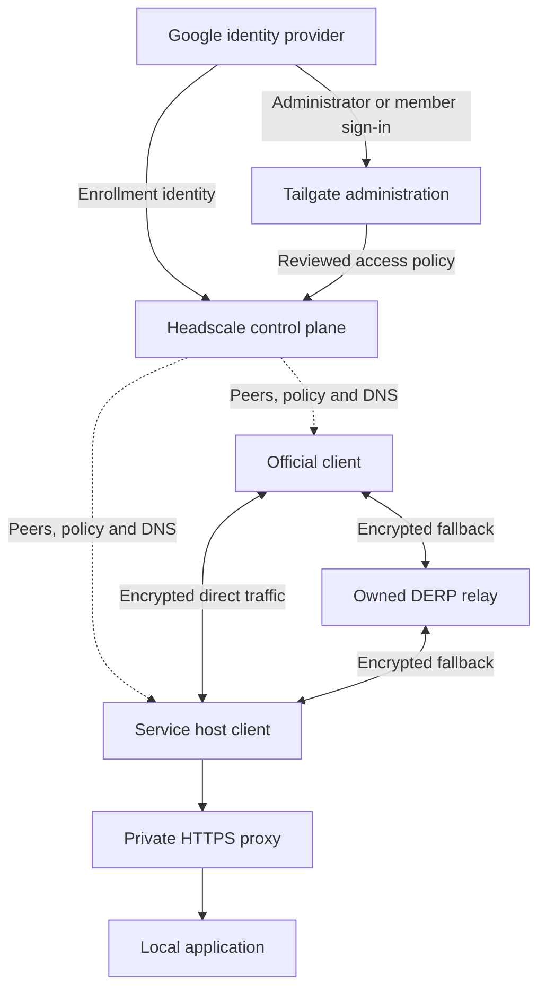

# Tailgate

Tailgate is a reusable foundation for a company-operated private network. It brings together Headscale, official Tailscale clients, owned DERP relays, private HTTPS and a first-party access-review console. The networking software stays upstream; Tailgate supplies the configuration, approval workflow and reproducible build and validation tools around it.

## Why Tailgate exists

A company needs more than a way to connect devices. It needs to decide who may join, which devices may reach which services, how those decisions are reviewed, and how the network can be recovered or changed safely.

Tailgate separates **identity, enrollment and access**. Google sign-in identifies a person. Enrollment registers a device with Headscale. A reviewed policy grants specific source devices access to specific destination services. An enrolled device receives no application access from domain membership alone.

The same separation applies to operations: generic components live here, while company identities, infrastructure and rollout evidence belong in a deployment repository pinned to an exact core revision.

## High-level architecture



Headscale coordinates clients; it is not the normal application data path. Clients establish encrypted peer connections, using an owned relay when a direct path is unavailable. A pilot can use Headscale's embedded relay; a larger deployment can supply standalone relays. Private application HTTPS uses DNS-01 certificates and an Nginx listener on the enrolled address.

The administration component adds company requests, device and team proposals, explicit approval, revocation and operational status. A public information site supplies homepage and consent disclosures. Both are separate builds, so rendering a controller bundle does not automatically install them. An optional migration gateway supports selected traffic between separately addressed networks.

Read the [architecture guide](docs/architecture.md) for trust boundaries and flows, or the [component interfaces](docs/components.md) for implementation details.

## Start here

| Task | Guide |
| --- | --- |
| Understand the design | [Architecture](docs/architecture.md) |
| Validate inputs or render a bundle | [Development](docs/development.md) · [input contract](schemas/README.md) |
| Preview or integrate the console | [Administration component](components/admin/README.md) |
| Run a disposable review environment | [Docker lab](docs/docker-lab.md) |
| Connect two networks during migration | [Gateway component](components/gateway/README.md) |
| Review versions, artifacts and licenses | [Upstream provenance](docs/provenance.md) |
| Stage a private full-stack application | [Application deployment CLI](docs/applications.md) |
| Browse all documentation | [Documentation index](docs/README.md) |

## Try the configuration tools

From this repository, with Python 3.9+:

```sh
python3 tools/tailgate.py validate examples/pilot.json
python3 tools/tailgate.py render examples/pilot.json --output build/pilot
```

Use a fresh output directory: rendering refuses nonempty destinations. The bundle contains configuration, policy, service definitions and receipts, with secret references rather than secret values. This example renders files locally; it does not install or enroll anything. See [development](docs/development.md) for builds, previews and isolated checks.

## Boundaries

Policy starts deny-all. Registering a service creates configuration, not permission to reach it. Database-backed approval deployments must initialize explicit deny-all policy before activation and keep the approval ledger consistent with controller state.

This repository does not provision company hosts, manage provider credentials or certify every client platform. Its isolated tests establish specific component behavior. A deployment must separately prove real identity callbacks, service access and denial, relay fallback, lifecycle behavior and recovery.
