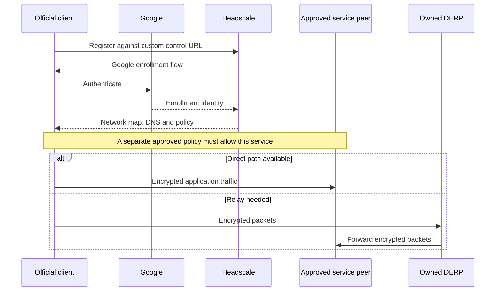
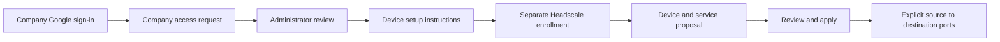

# Architecture

[Overview](../README.md) · [Documentation index](README.md)

## Design intent

Tailgate makes a private network operable without replacing the upstream networking protocol or its clients. The control plane, connection path and access-review interface have separate responsibilities. This lets a deployment change infrastructure or introduce a migration bridge without turning network membership into blanket service access.

## Coordination and traffic

Headscale owns device registration and distributes peers, policy and DNS settings. The controller's Nginx endpoint carries the control protocol and, in the pilot topology, embedded DERP. Co-location does not make controller coordination and relay transport the same role.

DERP supplies a fallback transport. Standalone relay admission uses the controller's verifier and is configured to fail closed when it is unavailable. Two relay hosts provide distinct transport locations, but verifier dependence still matters during a controller outage. See [component interfaces](components.md).

## Identity is not permission

This is the first-party onboarding journey. Company request approval unlocks setup instructions; it does not itself grant application permissions or replace Headscale's enrollment filters. Administrator sign-in uses a separate exact allowlist and durable identity pins. A company member does not become an administrator by enrolling.

The optional approval workflow owns the database-backed policy and a durable ledger. It represents selected devices with protected unique tags, preserving original ownership in its ledger. New devices, even for an existing person, need their own approval. Proposing a plan does not apply it; an explicit review action does. Self-review is allowed, so this is not a mandatory two-person process.

One policy writer must own this workflow. Restoring just the controller database or just the ledger can break that relationship; backups and recovery must preserve both plus identity state. See the [administration contract](../components/admin/README.md).

## Names, HTTPS and services

MagicDNS names identify enrolled devices; configured application records identify private services. Client DNS acceptance is needed for OS integration. DNS records describe where a service is, not who can access it.

A private application listener binds the enrolled IPv4 address on port 443 and proxies to a host-local backend. DNS-01 obtains a public certificate without opening a public application listener. A certificate establishes browser trust; network policy and application authentication still govern access. Different hostnames on the same IP and port do not create separate network authorization boundaries.

## Coexistence and migration

A deployment can keep an existing hosted client and add a Tailgate client in a separate namespace. Each needs its own state, identity, socket and routing. Namespaces preserve concurrent operation; switching a single client's account does not.

The optional [migration gateway](../components/gateway/README.md) goes further: two isolated official clients bridge a separately addressed destination IPv4 pool. Explicit hosted-user ownership checks gate bridge traffic and DNS, while the destination network independently authorizes the gateway's access. Source NAT means destination policy sees the gateway identity rather than each original user. An empty bridge user list denies everyone. IPv6 forwarding and reverse initiation are excluded.

## What is deliberately outside the component boundary

Provider IAM, real host inventory, secret delivery, public DNS changes, platform rollout and operational ownership are deployment responsibilities. Optional exit-node interfaces do not imply that internet egress is enabled or qualified. Local integration proves the exercised fixtures; it cannot certify Google Console settings, hosted-network configuration or production recovery.
